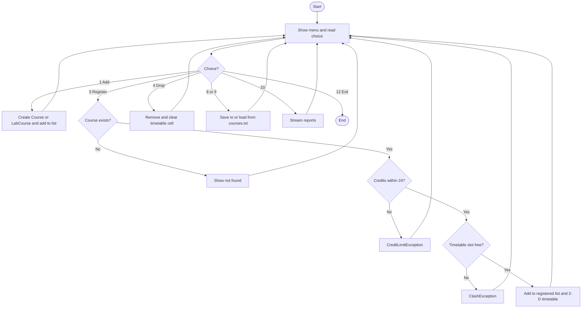

# Course Registration & Timetable Builder (Java)

Console application built for **26SC1101E – Problem Solving Using Programming (JAVA)**,
B.Tech Freshmen Engineering Department, KL University (A.Y 2026-27, Trimester I).

| | |
|---|---|
| Student | V. Bhuvan Sai Teja (Roll No. 2620030671) |
| Teammate | Shloka Bomma (Roll No. 2620030679) |
| Section / Team | 13 /  |
| Guide | _<add guide name>_ |
| Repository  |

## 1. Problem statement
Students pick courses by hand, can go over the credit limit, and may end up with two classes at
the same time. This program lets a student add courses, register and drop them, see a weekly
timetable, and it blocks credit-limit and clash errors automatically.

## 2. Features (12 menu options)
1. Add course (Theory or Lab) &nbsp; 2. Show courses &nbsp; 3. Register &nbsp; 4. Drop
5. Weekly timetable &nbsp; 6. Sort (ID, name, credits) &nbsp; 7. Search by name
8. Save to file &nbsp; 9. Load from file &nbsp; 10. Reports (streams) &nbsp; 11. Sample data &nbsp; 12. Exit

Rules: maximum **24 credits**; no two courses in the same day and time slot.

## 3. Project structure
The whole program is **one file**: `CourseRegistration.java` (about 290 lines).

| Part of the file | What it contains |
|---|---|
| Top | Constants, arrays (`DAYS`, `TIMES`), the 2-D `timetable`, the course lists |
| Classes | `Course`, `LabCourse` (inheritance), `ClashException`, `CreditLimitException` |
| Helper methods | `readInt()`, `readText()`, `dayIndex()`, `totalCredits()` (recursion), `find()` (Optional) |
| Features | `addCourse()`, `register()`, `drop()`, `showTimetable()`, `sortCourses()`, `search()` |
| Files | `save()`, `load()` |
| Reports | `reports()` (lambdas and streams) |
| `main()` | The `do-while` menu with a `switch` |

## 4. How to compile and run
Requires **JDK 17 or newer**.
```bash
javac CourseRegistration.java
java CourseRegistration
```
Quick demo: choose **11** (sample data) -> **3** with `CS101` -> **3** with `CS103` (clash error)
-> **5** (timetable) -> **10** (reports).

## 5. Algorithm
1. Start. Show the menu and read the choice (**do-while** until Exit).
2. **Add course:** read type, ID, name, credits, day, slot. If the ID exists or the data is
   invalid, show an error, else add it to the list.
3. **Register:** find the course (else "not found"). If it is already registered, stop.
   If `current credits + course credits > 24`, throw *CreditLimitException*.
   If the timetable cell (day, slot) is taken, throw *ClashException*.
   Otherwise add it to the registered list and put it in the 2-D timetable.
4. **Drop:** find it in the registered list, remove it, clear its timetable cell.
5. **Timetable:** loop over every (time, day) cell and print it.
6. **Total credits** is computed with recursion: `total(i) = credits[i] + total(i + 1)`.
7. **Save / Load:** write one CSV line per course; when loading, split each line and skip bad lines.
8. **Reports:** use stream pipelines on the course list.



## 6. Course Outcome (CO) mapping
Search the source for the tag (for example `CO4`) to find each use.

| CO | Topics | Where in the code |
|---|---|---|
| **CO1** From Problem to Program | Algorithm, constants, variables, expressions, Scanner input, formatted output | `readInt()`, `main()`, `String.format` in `showTimetable()`, Section 5 above |
| **CO2** Control Flow | `if-else`, `switch`, `do-while`, `while`, `for` | `main()`, `readInt()`, `register()`, `showTimetable()` |
| **CO3** Methods, Recursion, Arrays | Methods, **recursion**, **1-D** and **2-D arrays** | `totalCredits()` (recursion), `DAYS` / `TIMES` (1-D), `timetable` (2-D) |
| **CO4** Objects That Fail Safely | Classes, constructors and overloading, `this`, encapsulation, inheritance, polymorphism, **exceptions** | `Course`, `LabCourse` (overrides `getHours()`), `ClashException`, `CreditLimitException`, `check()` (`throws`), `register()` (multi-catch, `finally`) |
| **CO5** Strings, Library Algorithms, Files | `StringBuilder`, `equalsIgnoreCase`, `split`, `Comparable`, `Comparator`, `Files`/`Path` | `showTimetable()`, `sortCourses()`, `Course.compareTo()`, `save()`, `load()` |
| **CO6** Collections & Streams | `ArrayList`, `Map`, `Set`, lambdas, `Predicate`, method references, streams, `Collectors`, `Optional` | `courses` list, `find()`, `search()`, `reports()` |

### Evaluation checklist mapping (page 2 of the review form)
| Checklist focus | Evidence in this project |
|---|---|
| CO1 From Problem to Program | Algorithm and flowchart (Section 5), Scanner I/O |
| CO2 Loops and conditions | Menu loop, `switch`, validation loops, clash and credit conditions |
| CO3 Applying methods | Small methods, recursion, arrays |
| CO4 Exception handling | 2 custom exceptions, `throw`/`throws`, multi-catch, `finally` |
| CO5 Constructors and polymorphism | Overloaded constructors with `this(...)`; `LabCourse` overrides `getHours()` |
| CO6 Project quality, GitHub, deployment | This README, commits (Section 8), runnable release (Section 9) |

## 7. Sample output
```
Course ID to register: CS103
Registration failed: Clash with CS101
Total credits now: 4 / 24

Time   | Monday     | Tuesday    | Wednesday  | Thursday   | Friday
9:00   | CS101      | -          | PH101      | -          | -
12:00  | -          | -          | -          | -          | CS102L
```

## 8. Work split and commits (2-person team)
| Member | Part of the file |
|---|---|
| V. Bhuvan Sai Teja | `Course`, `LabCourse`, both exceptions, `check()`, `register()`, `drop()`, `showTimetable()`, `totalCredits()` |
| Shloka Bomma | Constants and arrays, `readInt()`, `main()` menu, `sortCourses()`, `search()`, `save()` / `load()`, `reports()`, README |

Build the file in small steps and commit after each one. Both of you should commit.

| # | Commit message | Who |
|---|---|---|
| 1 | Initial commit: README and .gitignore | Shloka |
| 2 | Add constants, arrays and input helpers | Shloka |
| 3 | Add Course class with constructors and getters | Bhuvan |
| 4 | Add LabCourse (inheritance) and custom exceptions | Bhuvan |
| 5 | Add addCourse and showCourses | Shloka |
| 6 | Add register with credit and clash checks | Bhuvan |
| 7 | Add recursive totalCredits and drop | Bhuvan |
| 8 | Add 2-D timetable display with StringBuilder | Bhuvan |
| 9 | Add sorting and search | Shloka |
| 10 | Add save and load file handling | Shloka |
| 11 | Add stream reports | Shloka |
| 12 | Add main menu | Shloka |
| 13 | Complete README with algorithm and CO mapping | Shloka |

Only commit work that really changed in each step.

## 9. Deployment (GitHub Release)
```bash
mkdir out
javac -d out CourseRegistration.java
jar --create --file CourseRegistration.jar --main-class CourseRegistration -C out .
java -jar CourseRegistration.jar
```
Upload `CourseRegistration.jar` under **GitHub -> Releases -> Draft a new release**.

## 10. Possible future work
Student login, GUI, database storage, prerequisite checking.
